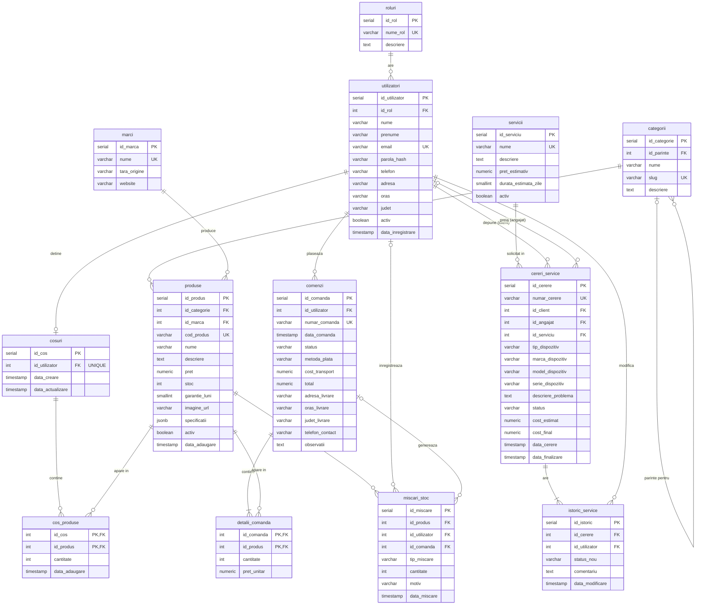

# TECHGUARD – Etapa 1: Modelare
## Pasul 4 – Relațiile dintre tabele

### Tipuri de relații (explicație)
| Tip | Ce înseamnă | Cum se realizează |
|---|---|---|
| **One-to-One (1:1)** | Unui rând din A îi corespunde cel mult un rând din B | Cheie străină cu `UNIQUE` |
| **One-to-Many (1:N)** | Unui rând din A îi corespund mai multe rânduri din B | Cheie străină în tabelul „mulți” (B) |
| **Many-to-Many (N:M)** | Mai multe rânduri din A se leagă de mai multe din B | **Tabel de legătură** cu două chei străine |
| **Recursivă** | Tabelul se leagă de el însuși | Cheie străină spre propriul tabel |

**Cardinalitate** = câte rânduri pot participa la relație, de ex. `1 : 0..N` = „unu la zero sau mai mulți”.

### Lista relațiilor

| # | Relație | Tip | Cardinalitate | Cheia străină | Explicație |
|---|---|---|---|---|---|
| 1 | roluri → utilizatori | 1:N | 1 : 0..N | `utilizatori.id_rol` | Un rol are mulți utilizatori; fiecare utilizator are exact un rol |
| 2 | utilizatori → cosuri | **1:1** | 1 : 0..1 | `cosuri.id_utilizator` (UNIQUE) | Un client are cel mult un coș; angajații nu au coș |
| 3 | cosuri ↔ produse | **N:M** | prin `cos_produse` | `cos_produse.id_cos`, `cos_produse.id_produs` | Un coș are mai multe produse; un produs poate fi în mai multe coșuri |
| 4 | utilizatori → comenzi | 1:N | 1 : 0..N | `comenzi.id_utilizator` | Un client poate plasa oricâte comenzi |
| 5 | comenzi ↔ produse | **N:M** | prin `detalii_comanda` | `detalii_comanda.id_comanda`, `detalii_comanda.id_produs` | O comandă are mai multe produse; un produs apare în mai multe comenzi |
| 6 | categorii → categorii | **Recursivă** 1:N | 1 : 0..N | `categorii.id_parinte` | O categorie are mai multe subcategorii |
| 7 | categorii → produse | 1:N | 1 : 0..N | `produse.id_categorie` | O subcategorie conține mai multe produse |
| 8 | marci → produse | 1:N | 1 : 0..N | `produse.id_marca` | O marcă are mai multe produse |
| 9 | produse → miscari_stoc | 1:N | 1 : 0..N | `miscari_stoc.id_produs` | Un produs are multe mișcări de stoc |
| 10 | utilizatori → miscari_stoc | 1:N (opțională) | 0..1 : 0..N | `miscari_stoc.id_utilizator` | Angajatul care a făcut mișcarea (NULL = automat) |
| 11 | comenzi → miscari_stoc | 1:N (opțională) | 0..1 : 0..N | `miscari_stoc.id_comanda` | Ieșirile de stoc generate de o comandă |
| 12 | servicii → cereri_service | 1:N | 1 : 0..N | `cereri_service.id_serviciu` | Un serviciu e solicitat în multe cereri |
| 13 | utilizatori (client) → cereri_service | 1:N | 1 : 0..N | `cereri_service.id_client` | Un client poate depune mai multe cereri |
| 14 | utilizatori (angajat) → cereri_service | 1:N (opțională) | 0..1 : 0..N | `cereri_service.id_angajat` | Un angajat preia mai multe cereri; cererea nouă nu are încă angajat |
| 15 | cereri_service → istoric_service | 1:N | 1 : 1..N | `istoric_service.id_cerere` | O cerere are cel puțin o înregistrare (prima: „inregistrata”) |
| 16 | utilizatori → istoric_service | 1:N | 1 : 0..N | `istoric_service.id_utilizator` | Cine a schimbat stadiul |

**Rezumat:** 1 relație 1:1 · 2 relații N:M · 1 relație recursivă · restul 1:N.

### Ce se întâmplă la ștergere (`ON DELETE`)
| Situație | Comportament | De ce |
|---|---|---|
| Se șterge un coș | se șterg și rândurile din `cos_produse` (**CASCADE**) | Produsele din coș nu au sens fără coș |
| Se șterge o cerere de service | se șterge și istoricul ei (**CASCADE**) | Istoricul aparține cererii |
| Se încearcă ștergerea unui produs, client, rol, categorii sau mărci folosite în alte tabele | **interzis** (**RESTRICT**) | Protejează comenzile și istoricul; se folosește `activ = FALSE` |
| Comenzile | nu se șterg niciodată, se trec în `anulata` | Documente cu valoare contabilă |

---

## Pasul 5 – Diagrama ERD

Diagrama este scrisă în **Mermaid**. Se vede desenată direct pe GitHub, în VS Code (Ctrl + Shift + V, cu extensia *Markdown Preview Mermaid Support*) sau pe [mermaid.live](https://mermaid.live).

Legenda liniilor: `||` = exact unul · `o|` = zero sau unul · `o{` = zero sau mai mulți · `|{` = unul sau mai mulți

