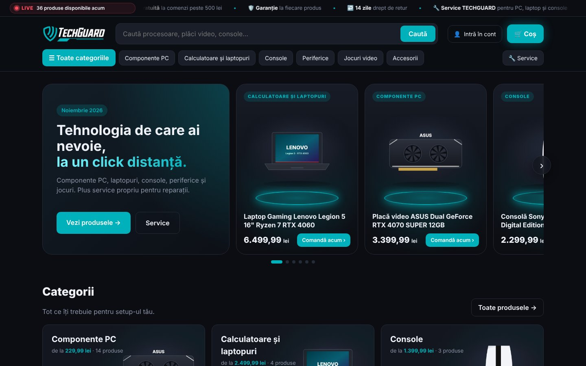
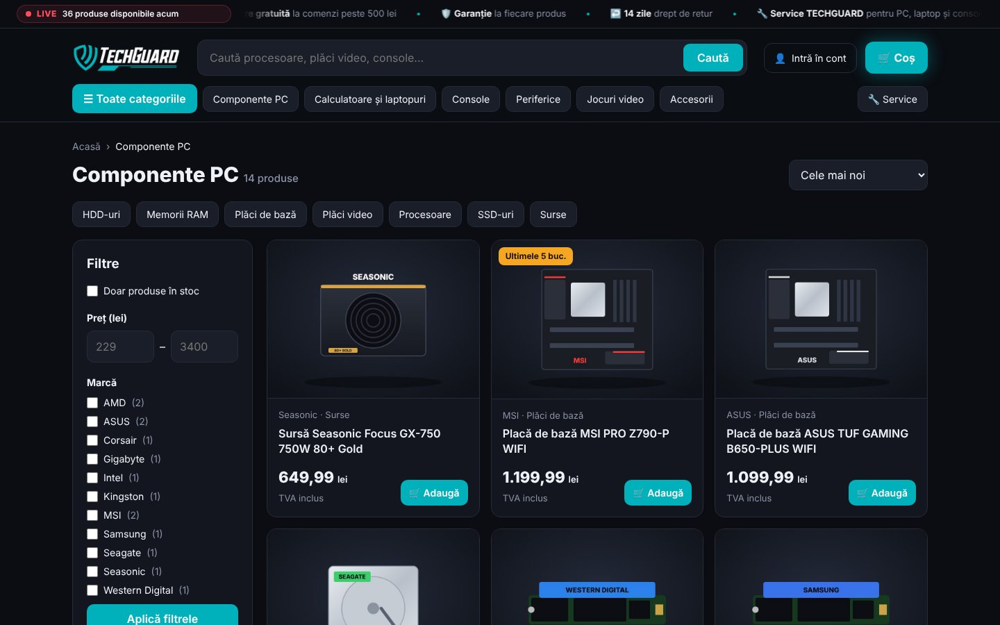
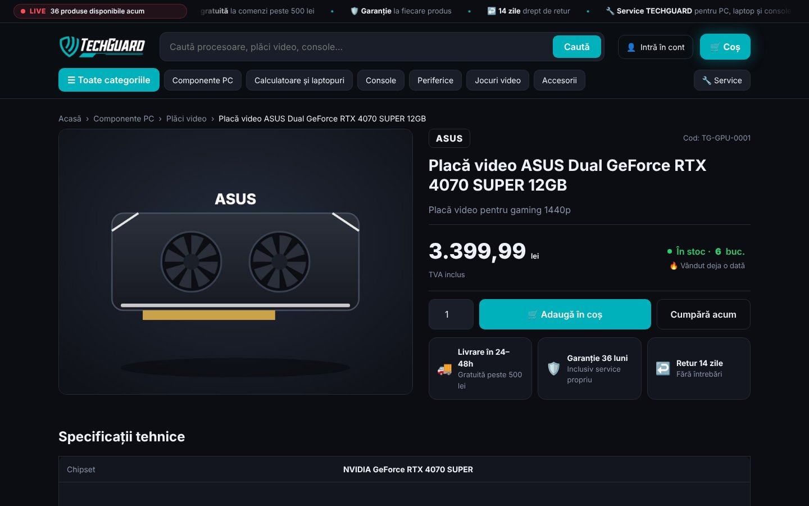
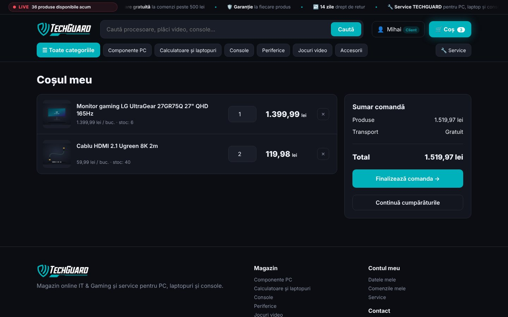
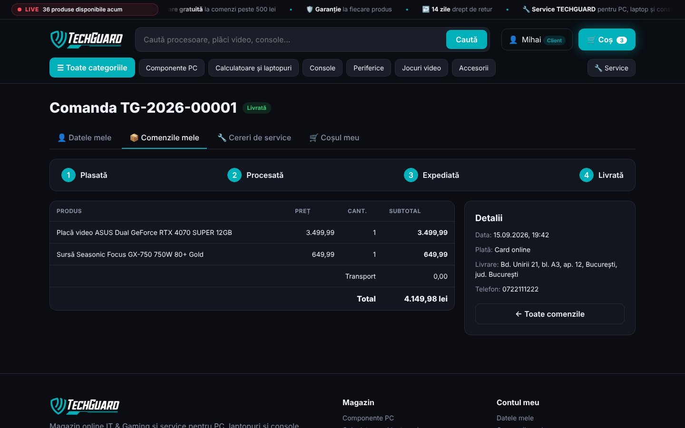
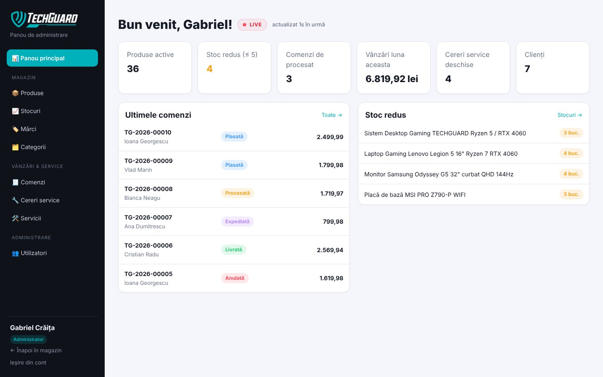
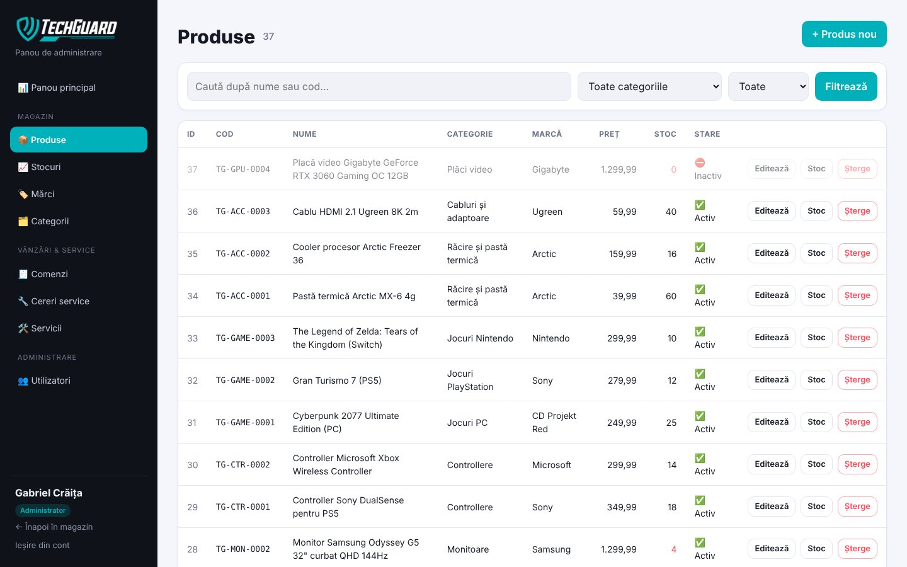
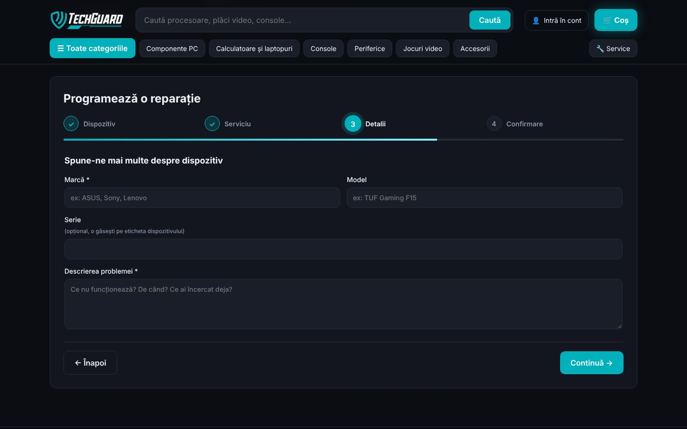
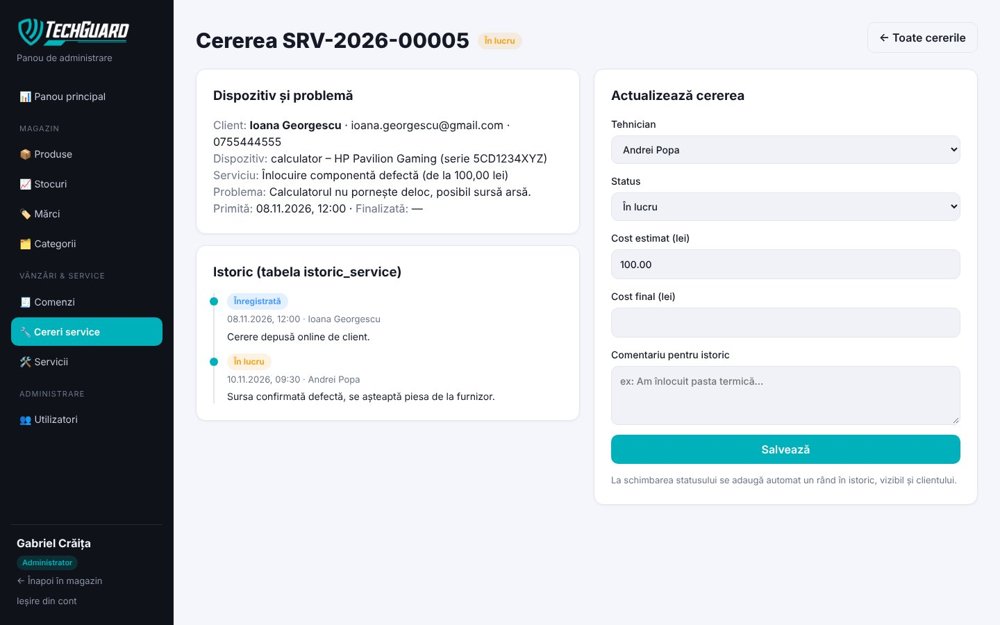
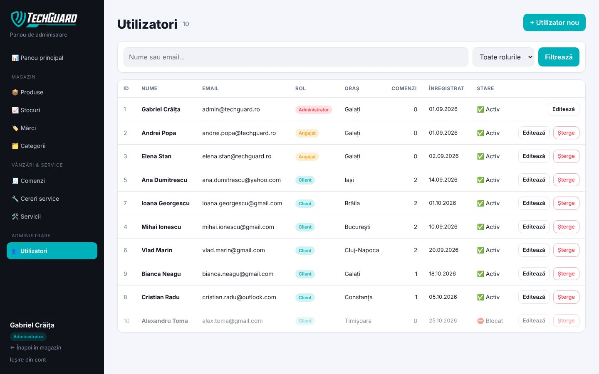

<p align="center">
  
</p>

# TECHGUARD – Magazin online IT & Gaming

Proiect pentru disciplina **Baze de Date Avansate** (2026–2027)
Student: **Crăița Gabriel Ștefan** · Grupa **22C31A** · Universitatea „Dunărea de Jos” din Galați

Magazin online pentru produse IT & Gaming (componente, calculatoare, laptopuri, console,
periferice, jocuri), cu zonă proprie de **service** pentru mentenanță și reparații.



## Etapele proiectului
| Etapă | Conținut | Stare | Documentație |
|---|---|---|---|
| 0 – Tema | Domeniu, funcționalități, roluri | ✅ Finalizată | [`docs/Etapa0`](docs/Etapa0) |
| 1 – Modelare | 13 tabele, relații, PK/FK, date de test | ✅ Finalizată | [`docs/Etapa1`](docs/Etapa1) |
| 2 – CRUD | Magazin, coș, comenzi, panou de administrare | ✅ Finalizată | [`docs/Etapa2`](docs/Etapa2/Etapa2_CRUD.md) |
| 3 – Autentificare | Înregistrare, login, 3 roluri | 🟡 Implementată, documentația urmează | – |
| 4 – Performanță | Indecși, optimizare, load test | ⏳ | – |
| 5 – Rapoarte | Export PDF / CSV / Excel | ⏳ | – |
| 6 – Susținere | Prezentare finală | ⏳ | – |

## Funcționalități
**Magazin (oricine):** prima pagină cu banner rotativ și categorii cu „de la X lei”, rânduri glisante cu cele mai
vândute produse și noutăți, catalog cu filtre (stoc, preț, marcă), sortare și paginare, **căutare cu sugestii live**,
pagina produsului cu specificații tehnice (JSONB) și **stoc actualizat în timp real**.

**Client:** cont nou și autentificare, coș de cumpărături (adăugare fără reîncărcarea paginii), plasarea comenzii
(tranzacție), istoricul comenzilor, anularea unei comenzi „plasate”, **cerere de service în 4 pași**
(dispozitiv → serviciu → detalii → confirmare, cu cost și dată estimată), istoricul reparației, editarea datelor și a parolei.

**Angajat:** panou de administrare **LIVE** (statistici și comenzi noi actualizate automat la 5 secunde),
produse, stocuri (mișcări de stoc), mărci, comenzi (schimbare status), cereri de service (tehnician, status, costuri).

**Administrator:** tot ce face angajatul + categorii, servicii și utilizatori (roluri, blocare cont).

**Interfață:** temă întunecată cu accent turcoaz (identitatea TechGuard), animații la scroll, slidere cu animație
cursivă, bandă derulantă și indicatori LIVE (date reale din BD), notificări toast, ferestre de confirmare proprii,
meniuri animate, derulare lină a paginii.

## Capturi de ecran
| Catalog | Pagina produsului |
|---|---|
|  |  |
| **Coș** | **Comandă client** |
|  |  |
| **Panou de administrare** | **Administrare produse** |
|  |  |
| **Cerere de service – 4 pași** | **Cerere de service (admin)** |
|  |  |
| **Utilizatori** | |
|  | |

## Structura proiectului
```
PROIECT BD/
├── README.md                         ← această pagină
├── app/                              ← aplicația web (Node.js + Express + EJS)
│   ├── server.js                     ← pornește serverul, sesiunile, meniul comun
│   ├── db.js                         ← conexiunea la PostgreSQL (Pool)
│   ├── .env.example                  ← model pentru setările bazei de date
│   ├── routes/
│   │   ├── public.js                 ← acasă, catalog, căutare, produs, service
│   │   ├── auth.js                   ← login, înregistrare, logout
│   │   ├── client.js                 ← coș, comandă, contul meu
│   │   └── admin.js                  ← panoul de administrare (CRUD)
│   ├── lib/operatii.js               ← operații în tranzacții (comandă, stoc, service)
│   ├── middleware/auth.js            ← verificarea rolurilor
│   ├── views/                        ← paginile (EJS): magazin, cont, admin, partials
│   └── public/                       ← CSS, JavaScript (animații, live), logo, imaginile produselor
├── database/                         ← baza de date PostgreSQL
│   ├── 01_schema.sql                 ← creează cele 13 tabele
│   ├── 02_date_test.sql              ← datele de test (fixtures)
│   ├── 03_verificare.sql             ← interogări de verificare
│   └── rezultat_verificare.txt       ← rezultatul ultimei rulări
├── docs/                             ← documentația fiecărei etape
│   ├── Etapa0/  TECHGUARD_Etapa0_Tema.pdf
│   ├── Etapa1/  TECHGUARD_Etapa1_Modelare.pdf, ERD, normalizare
│   ├── Etapa2/  Etapa2_CRUD.md (arhitectură, CRUD, descrierea paginilor)
│   └── screenshots/                  ← capturi de ecran ale aplicației
└── scripts/                          ← scripturi de lucru (dublu-click)
    ├── ruleaza_etapa1.bat            ← creează și populează baza de date
    ├── porneste_site.bat             ← pornește site-ul (http://localhost:3000)
    ├── publica_github.bat            ← urcă modificările pe GitHub (cere un mesaj)
    └── publica_rapid.bat             ← urcă modificările pe GitHub fără întrebări
```

## Instalare și pornire
1. **Baza de date** – dublu-click pe `scripts\ruleaza_etapa1.bat` și introdu parola utilizatorului `postgres`.
2. **Node.js** – instalează versiunea LTS de pe https://nodejs.org
3. **Setări** – copiază `app\.env.example` ca `app\.env` și completează `DB_PASSWORD=` cu parola de PostgreSQL.
4. **Pornire** – dublu-click pe `scripts\porneste_site.bat` → se deschide http://localhost:3000

<details>
<summary>Crearea bazei de date manual, din PowerShell</summary>

```powershell
cd "A:\PROIECT BD"
$psql = "A:\APLICATII\POSTGRESS\bin\psql.exe"
& $psql -U postgres -c "CREATE DATABASE techguard"
& $psql -U postgres -d techguard -f database\01_schema.sql
& $psql -U postgres -d techguard -f database\02_date_test.sql
& $psql -U postgres -d techguard -f database\03_verificare.sql
```
</details>

## Conturi de test
Parola pentru toate conturile: `Parola123!`
| Rol | Email |
|---|---|
| Administrator | `admin@techguard.ro` |
| Angajat | `andrei.popa@techguard.ro` |
| Client | `mihai.ionescu@gmail.com` |

## Tehnologii
- **Bază de date:** PostgreSQL 18 – 13 tabele, chei străine, constrângeri `CHECK`/`UNIQUE`, JSONB, tranzacții
- **Server:** Node.js + Express, pachetul `pg` (SQL scris manual, parametrizat)
- **Pagini:** EJS + CSS propriu (temă întunecată pentru magazin, temă deschisă pentru administrare)
- **Autentificare:** `express-session` + parole criptate cu `bcryptjs`
